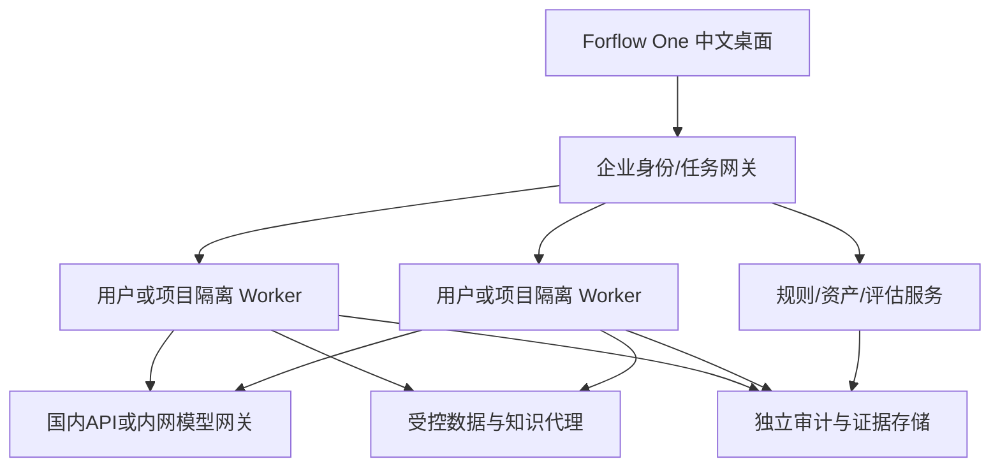

# 模型与私有部署

## 首先验证国内 API

用户已决定稍后配置凭据，当前先完成开发与无凭据验证。CLI 路线见 [国内 CLI 接入](domestic-cli.md)。

本轮先选阿里云百炼北京地域作为可核验的接入样例，并非已替用户采购或指定最终供应商。最新官方文档支持按地域配置业务空间专属域名；地域和 API Key 必须匹配。[Qwen Code 配置](https://help.aliyun.com/zh/model-studio/qwen-code)、[文本生成接口](https://help.aliyun.com/zh/model-studio/text-generation)

本机 `.forflow/model.env` 已创建，权限 0600，Git 忽略。填写实际值：

```dotenv
FORFLOW_MODEL_BASE_URL=https://实际WorkspaceId.cn-beijing.maas.aliyuncs.com/compatible-mode/v1
FORFLOW_MODEL_ID=qwen-plus
FORFLOW_MODEL_API_KEY=实际密钥
```

模型 ID 以账户实际开通为准。也可使用该地区仍支持的 `https://dashscope.aliyuncs.com/compatible-mode/v1`；探针仅接受这两类北京域名。此域名限制是当前连接器的明确范围，不是所有国内厂商统一接口；以后接 DeepSeek／智谱／火山等，应按官方端点和能力另加 provider profile。

执行 `pnpm probe:model:forflow`。脚本读取本机配置或进程环境，只发送固定的合成文本，输出状态、HTTP 状态、耗时与数字用量；不保存密钥、回复正文或错误正文。拒绝重定向，30 秒超时、响应体上限 1 MiB。结果写入 `.forflow/evidence/model-probe.json`。

本轮凭据检查只查看“是否设置”，未读取或复制用户其他应用的密钥。当前所需端点与密钥缺失，结果为 **not-run**；模拟接口通过不代表真实模型已接通。真实 API 请求可能按厂商账户计量。

## 同一合同支持内网模型

把 endpoint、model 和凭据改为客户网关后执行 `pnpm probe:model:forflow --intranet`。默认要求 HTTPS；仅本机回环地址允许 HTTP 方便测试。配置只证明简单非流式文本兼容，后续必须验证流式分片、reasoning字段、tool calls/并行工具、JSON schema、图片、取消、token统计和错误码。

国内 API 和内网模型的差异应放在 provider adapter 与能力声明，不分叉整套产品。网关保存：供应商/地域、允许模型、凭据引用、超时、上下文限制、费用口径、出站策略版本；密钥由执行主机的凭据服务提供。

`resources/forflow/opencode.example.json` 是后续执行器接入模板，设置企业 provider、默认及 small model、禁止分享、关闭自动更新。OpenCode 支持 provider allowlist、自定义 baseURL 和环境变量密钥；其配置会合并，项目配置与管理配置的优先级必须核验。[官方配置](https://opencode.ai/docs/config/)、[官方 provider 文档](https://opencode.ai/docs/providers/)

模板的 `@ai-sdk/openai-compatible` 指协议适配包，不意味着请求发给 OpenAI。实际目的地由 baseURL 决定；包本身仍是第三方供应链项。生产还需锁定执行器及 SDK、准备内部包缓存、禁用自动下载、隔离配置目录并验证实际出站，不能单靠 allowlist 宣称离线。

## 第一版推荐拓扑



一个客户一个部署域；单个 Orca runtime 保持其执行权限范围。不同客户或有严格隔离要求的人员不共享同一 OS 用户和通用 runtime token。服务身份只获得指定目录、仓库、模型与数据代理权限；模型网关不承担全部数据授权。

远程运行按既有 runtime/SSH adapter 接入。上游 `orca serve` 仍包含 Electron/native/Xvfb 等依赖，不能等同于轻量 Node HTTP 服务。`--pairing-address` 是宣告连接地址，不能当成监听绑定策略；必须实测 listener 地址、认证/TLS、反向代理与防火墙。公网端口、0.0.0.0 暴露和客户内网路由应作为部署验收项。

先用一个 Linux VM 或经验证容器完成单客户开发环境，再固化 systemd/镜像。是否使用 Kubernetes 取决于规模和客户运维条件，不先强加编排平台。

## 出站与供应链逐层替换

| 层 | 要准备的内部能力 | 验证方式 |
| --- | --- | --- |
| 构建 | Git镜像、npm/pnpm缓存、Electron/native归档、锁文件、构建runner | 清空联网缓存后用内网源重建；制品hash与依赖清单相符 |
| 应用平台 | 身份、更新、支持包、推送、分享、插件源 | 禁止上游默认端点；失败时无隐式外网回退 |
| 模型执行器 | 固定二进制与SDK、凭据、地域/model配置、联网与工具权限 | 检查进程树和全进程DNS/流量，不只Electron请求 |
| 数据/协作 | 内网Git与数据代理、知识索引、按需飞书等连接器 | 对象权限、导出与写动作验收；外部消息仍需业务授权 |
| 运行环境 | OS/CPU/native库、镜像签名、密钥、监控、备份 | 客户目标平台实测，关闭公网后的完整工作流 |
| 交付 | 独立安装包/签名、内部升级源、SBOM、第三方声明、恢复方案 | 新装/并存/升级/回滚/卸载回归与客户现场验收 |

第一版 `cn-private` 是首批平台服务禁用策略，**不是系统防火墙**。禁止上传一类支持包不能阻止用户终端运行 curl；选了国内模型也不能约束第三方插件的遥测。最终边界由执行主机隔离和网络层共同建立。

## 接续部署前需要补齐的事实

当前唯一影响真实 API 联调的输入是可用端点、模型和本机凭据。正式私有部署前再确定客户目标 OS/CPU、联网与离线要求、SSO方式、数据分级及保留要求、安装/签名身份；这些事实应进入该客户部署档案，不把推测写成全公司默认约束。
